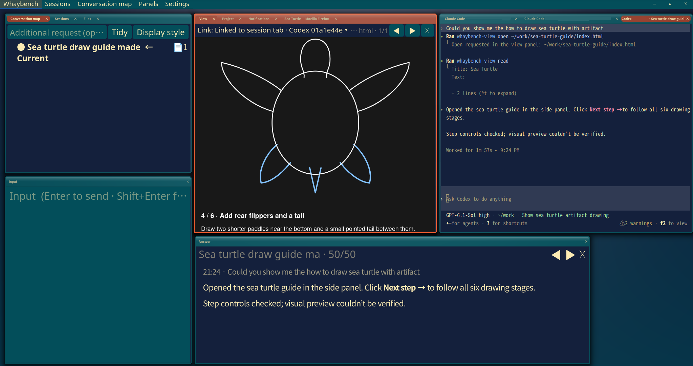

<h1 align="center">Whaybench</h1>

<p align="center"><i>/ˈwaɪ.bɛntʃ/, said like "why bench"</i></p>

<p align="center"><b>Long conversations with your coding agent, without losing the thread.</b></p>

<p align="center">Claude Code (and Codex CLI, experimental) in one workspace that remembers what was decided,<br>
which session did what, and everything the agent showed you.</p>

<p align="center">
  <a href="https://github.com/Whaybench/whaybench/releases/latest"></a>
  <a href="/LICENSE"></a>
  
</p>

<p align="center">
  
</p>

## Get started

### Windows

1. Download **[WhaybenchSetup.exe](https://github.com/Whaybench/whaybench/releases/latest/download/WhaybenchSetup.exe)**.
2. Run it. Windows warns about an unknown app: click **More info**, then **Run anyway**.
3. Wait while it installs everything. Windows may restart once; the setup goes on by itself.
4. Start **Whaybench** from the Start menu and sign in to Claude in the browser that opens.

Needs Windows 11, or Windows 10 21H2 or newer (64-bit). Setup stopped with an error? See
[Installing on Windows: when the setup stops](/docs/windows.md).

### Linux

1. Install Whaybench:

   ```sh
   curl -fsSL https://github.com/Whaybench/whaybench/releases/latest/download/install.sh | sh
   ```

   It finds what your Linux is missing and installs it for you: answer `y` and type your password.

2. Start it:

   ```sh
   whaybench
   ```

Needs a Wayland desktop and [Claude Code](https://code.claude.com/docs) installed and signed in.

Ask your agent something and watch the map grow.

## Stop scrolling back

**Every decision, where you can see it.** The agent keeps a live map of the conversation: topics, open questions,
and every decision written as *question → conclusion (reason)*.

**From a decision to the answer behind it.** Open a node on the map and the replies where that topic was discussed
come up.

**No lost sessions.** Every conversation is named from its map, shows whether it is working, waiting for you or done,
and is searchable. Close the window, and every tab comes back as it was.

## Everything in one place

**See what the agent sees.** Pages, PDFs, pictures and a real Firefox tab open beside the conversation.

**The answer, front and centre.** The latest answer gets a panel of its own, clear of tool calls.

**Your layout, your look.** Drag panels, stack them as tabs, and pick a theme: light, depth, see-through panels and
glass included.

## Built to stay out of your way

**Your agent, unchanged.** Claude Code or Codex CLI runs in its terminal as usual, with your own login. Whaybench
never calls an AI on its own.

**Private.** No server, no account, no telemetry. Everything stays on your computer.

<p align="center">
  <b>Whaybench is free and made by one developer.</b><br>
  If it saves you time, a coffee keeps it growing.<br><br>
  <a href="https://ko-fi.com/whaybench"></a>
</p>

## Learn more

- [Guide: updates, data folder, themes and languages, FAQ](/README.md)
- [Using Codex CLI (experimental)](/docs/codex.md)
- [Report a bug or suggest an idea](https://github.com/Whaybench/whaybench/issues)
- [Contributing](/AGENTS.md)

<sub>Whaybench is an independent project, not affiliated with or endorsed by Anthropic or OpenAI.
Licensed under [Apache 2.0](/LICENSE).</sub>
