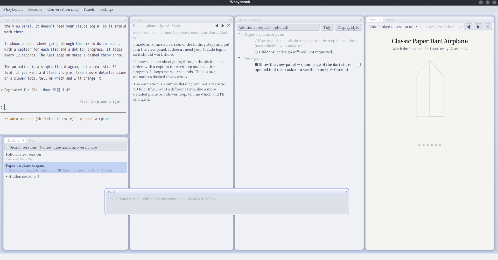

<h1 align="center">Whaybench</h1>

<p align="center"><b>Long conversations with your coding agent, without losing the thread.</b></p>

<p align="center">Claude Code and Codex CLI in one Linux workspace that remembers what was decided,<br>
which session did what, and everything the agent showed you.</p>

<p align="center">
  <a href="https://github.com/Whaybench/whaybench/releases/latest"></a>
  <a href="/LICENSE"></a>
  
</p>

<p align="center">
  
</p>

```sh
curl -fsSL https://github.com/Whaybench/whaybench/releases/latest/download/install.sh | sh
```

<p align="center">One line, no root, no account. The system packages for your distribution are in the
<a href="/README.md#install">install guide</a>.</p>

## Stop scrolling back

**Every decision, where you can see it.** The agent keeps a live map of the conversation as it talks:
topics, open questions, and every decision written as *question → conclusion (reason)*. An hour later,
the answer to "why did we do it this way?" is one glance away, not three hundred lines up.

**From a decision straight to the answer behind it.** Open a node on the map and its related answers come up:
the replies from the turns where that topic was discussed, one after another. The reasoning is never lost in
the scrollback.

**Context that survives compaction.** When the agent opens a file again, the decisions made about it come
with it. A compacted context no longer means a forgotten agreement.

**No lost sessions.** Every conversation is named from its map, shows whether it is working, waiting for
you or done, and is searchable by name, question and answer. Close the window, and every tab comes back
exactly as it was.

## Everything in one place

**See what the agent sees.** Pages, PDFs, pictures, diagrams, changed files and a real Firefox tab open
right beside the conversation, kept per session. No more hunting for the window the agent just opened.

**The answer, front and centre.** The latest answer gets a panel of its own, clear of tool calls, with
earlier ones a click away. An input box sends to whichever session you choose.

**Your layout, your way.** Drag panels by their title bar, stack them as tabs, resize them together.
Each panel zooms with Ctrl+wheel and remembers it.

<p align="center">
  <b>Whaybench is free and made by one developer.</b><br>
  If it saves you time, a coffee keeps it growing.<br><br>
  <a href="https://ko-fi.com/whaybench"></a>
</p>

## Built to stay out of your way

**Your agent, unchanged.** Claude Code or Codex CLI runs in its terminal exactly as usual, with your own
login. Whaybench reads what it records and shows it; it never calls an AI on its own.

**Private by design.** No server, no account, no telemetry. Everything stays in one folder on your computer.

**Fast and native.** A Wayland compositor written in Rust, with GTK 4 panels and Alacritty terminals.

## Make it yours

Every look and every language is an add-on: **one folder, nothing to compile.** Drop a folder into
`~/.local/share/whaybench/addons/`, pick it in Settings, and delete the folder to remove it.

| Add-on | What you change | What one folder holds |
|---|---|---|
| [Theme](/addons/themes/README.md) | Colours, fonts and panel look; edits show within 2 seconds | `theme.json` |
| [Language](/addons/languages/README.md) | Every text in the interface | `messages.ftl` and `language.json` |
| [Map style](/addons/map-styles/README.md) | How the conversation map is drawn | `style.json` |
| [Document template](/addons/project-docs/README.md) | Project documents the agent fills in | A Markdown file, with a Word original if you like |

Three themes, five map styles, a Korean language pack and a work breakdown template come included, ready to
copy and change.

**Your language in an afternoon.** A language pack is a single text file of plain `key = text` lines in the
[Fluent](https://projectfluent.org) format. Copy the Korean pack, translate the lines, and it appears under
Settings → Language. Share it back as a pull request and everyone gets it.

## Get started

1. Install the [system packages](/README.md#1-system-packages) for your distribution.
2. Run the one-line install above.
3. Start it:

   ```sh
   whaybench                  # with Claude Code
   whaybench --agent codex    # with Codex CLI
   ```

Ask your agent something and watch the map grow.

## Learn more

- [Full install guide, data folder and FAQ](/README.md)
- [Using Codex CLI](/docs/codex.md)
- [Add-on guides](/README.md#make-it-yours)
- [Report a bug or suggest an idea](https://github.com/Whaybench/whaybench/issues)
- [Contributing](/AGENTS.md)

<sub>Whaybench is an independent project, not affiliated with or endorsed by Anthropic or OpenAI.
Licensed under [Apache 2.0](/LICENSE).</sub>
