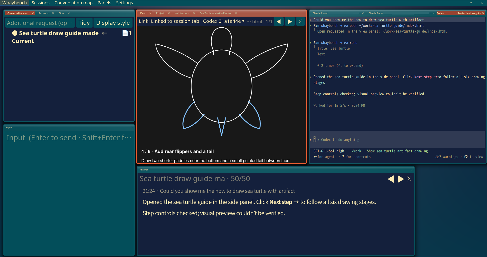

<h1 align="center">Whaybench</h1>

<p align="center"><b>Keep the thread of long conversations with your coding agent.</b><br>
Claude Code (Codex CLI experimental) with its conversation map, sessions, answers and everything it shows,<br>
side by side in one window.</p>

<p align="center">
  
</p>

> Whaybench is an independent project. It is not affiliated with or endorsed by Anthropic or OpenAI.

## Install

### Windows

1. Download
**[WhaybenchSetup.exe](https://github.com/Whaybench/whaybench/releases/latest/download/WhaybenchSetup.exe)**.
2. Run it. Windows warns about an unknown app: click **More info**, then **Run anyway**.
3. Wait while it installs everything. Windows may restart once; the setup goes on by itself.
4. Start **Whaybench** from the Start menu and sign in to Claude in the browser that opens in the middle of its window.

Needs an x86-64 PC with Windows 11, or Windows 10 21H2 or newer. The setup puts a Linux of its own in WSL with Claude
Code and
Codex CLI; your other WSL systems are not touched. If it stops, run it again and it goes on where it stopped. If it
stops with an error, [Windows setup help](docs/windows.md) shows how to fix it step by step.

Programs in WSL can reach your Windows files with your rights, so check what an agent wants to run before you allow
it.

### Linux

1. Install Whaybench:

   ```sh
   curl -fsSL https://github.com/Whaybench/whaybench/releases/latest/download/install.sh | sh
   ```

   On Fedora (Silverblue and Kinoite too), Ubuntu, Debian, Arch, openSUSE, AlmaLinux and Rocky Linux it shows the command for the system packages it needs
   (WebKitGTK, wl-clipboard, Firefox, fcitx5, an emoji font) and runs it with `sudo` once you answer `y`.

2. Start it:

   ```sh
   whaybench
   ```

Needs an x86_64 PC with a Wayland desktop, and [Claude Code](https://code.claude.com/docs) installed and signed in.
To type in Korean, Japanese, Chinese or another language, also install its fcitx5 engine (for Korean,
`fcitx5-hangul`).

### Update and remove

Whaybench updates itself and says so in its status line; **Whaybench → Restart** starts the new version.

- Windows: remove it in **Settings → Apps**. Your projects stay in `%LOCALAPPDATA%\Whaybench\work.vhdx`; see
  [docs/windows.md](docs/windows.md#removing-everything) to remove them too.
- Linux: delete `~/.local/lib/whaybench`, `~/.local/lib/whaybench-versions` and the `whaybench*` links in
  `~/.local/bin`. Remove the
  Claude Code plugin with `claude plugin uninstall context-map@whaybench`.

Your data stays in its folder (see below). Going back a version and checking a download: [Install](docs/install.md).

## Documentation

[Get started](docs/getting-started.md) walks through a first conversation in about 15 minutes. The
[documentation](docs/README.md) has the guides, the command and settings reference, and
[troubleshooting](docs/troubleshooting.md).

## What it does

- **Conversation map.** The agent keeps a tree of the conversation: topics, open questions, and decisions as
  "question → conclusion (reason)". Open a node to see the answers where it was discussed.
- **One memory across sessions.** A session is told what other sessions decided about the same problem. The
  notifications panel gathers what needs you.
- **Sessions.** Every conversation is listed with a name, its state and a search. Tabs come back after a restart.
- **View panel.** Pages, files, PDFs, pictures and a real Firefox tab open beside the conversation.
- **Answer, input and files.** The last answer in its own panel, an input box for the chosen session, and the files
  each session touched.
- **Layout and look.** Move, resize and stack panels as tabs. Themes set colours, light and depth, see-through panels
  and glass.
- **Projects.** A project map built from conversation nodes, and documents from your templates.
- **Briefsafe projects.** For work between you and your AI: a folder of its own, its agents in a container with that
  folder, its records encrypted while you are logged out, and snapshots you can go back to (see below).
- **Local.** No server, no account, no telemetry.

## Briefsafe projects

Some work is between you and your AI: a talk about a client, a plan not yet out. Give it a project. Every new project is
a Briefsafe project: press **New project** in the project panel, log in, and start a conversation in it.

- **It stays in the project.** Whaybench gives the project's map, memory and documents to its own conversations only,
  and
  has no server to send them to.
- **The agent sees one folder.** It runs in a rootless podman container with the project folder. Your system's and
  agents'
  programs are there too, read only; the rest of your home folder is not.
- **Encrypted while you are logged out.** The project's conversations, map and memory, and the documents Whaybench keeps
  for it, are encrypted with gocryptfs under a key in your keyring. A recovery key is shown once, when the project is
made: keep it somewhere safe.
- **Snapshots.** Press **Save state** to keep the whole folder as it is, and go back to it later.

Know its limits:

- The agent uses its model and the internet, as it does outside a project.
- Your own files in the project folder are not encrypted, logged out or not. Use disk encryption for those.
- While a project is logged in, other programs running as you can read all of it. Log out when you are done: quitting
  Whaybench can leave it open.
- The container needs `podman` and an image for your system (Fedora, Ubuntu, Debian); the encryption also needs
  `gocryptfs` and a keyring; snapshots need btrfs. The Windows setup brings them. Without them a project is made without
  that part, and Whaybench says so.

How to set it up, recover it and go back to a snapshot: [Briefsafe projects](docs/guide/briefsafe.md). What exactly is
protected: [Security](docs/security.md).

## Your data

Everything is in `~/.local/share/whaybench`. It is the main thing to copy when you move your setup. It holds the
sign-ins of the view
panel's browser, so keep it to yourself. Its `cache` folder can be deleted while Whaybench is closed.

Conversations are kept until you choose otherwise in **Settings → Preferences…**. Each Briefsafe project keeps its own
data in its folder, so copy those folders too. Backing up and moving to another computer:
[Settings and data](docs/reference/settings-and-data.md).

## Make it yours

Themes, languages, map styles and document templates are folders. English and Korean are included.

| Add-on | Folder in your data | Guide |
|---|---|---|
| Theme | `addons/themes/` | [addons/themes/README.md](addons/themes/README.md) |
| Language | `addons/languages/` | [addons/languages/README.md](addons/languages/README.md) |
| Map style | `addons/map-styles/` | [addons/map-styles/README.md](addons/map-styles/README.md) |
| Document template | `addons/project-docs/` | [addons/project-docs/README.md](addons/project-docs/README.md) |

## Codex CLI

Experimental. Open a Codex conversation from the menu (**Sessions → New conversation → Codex**) and trust its hooks once
with `/hooks`. See [Agents and add-ons](docs/guide/agents-and-add-ons.md).

## Build from source

You need Rust ([rustup](https://rustup.rs)), Git, Alacritty and the GTK 4 and WebKitGTK 6 development packages
(`gtk4-devel webkitgtk6.0-devel` on Fedora, `libgtk-4-dev libwebkitgtk-6.0-dev` on Ubuntu and Debian).

    git clone https://github.com/Whaybench/whaybench
    cd whaybench
    tools/fetch-smithay.sh
    cargo build --release
    target/release/whaybench

## How it works

Whaybench is a Wayland compositor written in Rust with [Smithay](https://github.com/Smithay/smithay). Each panel is
an app of its own: GTK 4 panels, Alacritty terminals, WebKit and Firefox views. The agent runs unchanged in the
terminal; its standard hooks call `whaybench hook`, and the map tool is the MCP server `whaybench mcp`.

Releases are signed with [minisign](https://jedisct1.github.io/minisign/), and Whaybench downloads an update only when
it checks against this key: `RWTwDOf9rBKzxEepAVlbLTan2g/RQFDuCZeqmU4Q+dNwf+wF+3a2Sfia`

## FAQ

**macOS?** Not yet: Whaybench needs Linux, on its own or in WSL on Windows. [Help bring it to the
Mac](https://ko-fi.com/whaybench).

**Does it call the AI itself?** Your agent works in its terminal as usual, and Whaybench shows what it records. The one
exception is yours to choose: a map style that needs more than the map holds has a small Claude model fill it in once.

**Does it change my Claude Code or Codex setup?** It adds one plugin to Claude Code. Codex gets a folder of its own.

## Contributing

Bug reports and ideas are welcome in [Issues](https://github.com/Whaybench/whaybench/issues). For code, see
[Development](docs/development.md) and [AGENTS.md](AGENTS.md).

## Support

Whaybench is made by one developer in their own time. If it helps you, you can buy me a coffee on
[Ko-fi](https://ko-fi.com/whaybench).

## License

[Apache License 2.0](LICENSE). Smithay's MIT notice is in [NOTICE](NOTICE).
