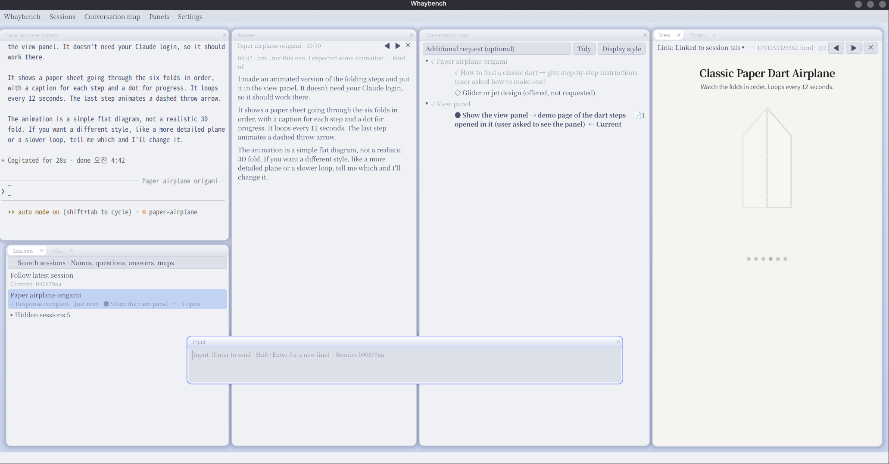

<h1 align="center">Whaybench</h1>

<b>Keep the thread of long conversations with your coding agent.</b> 
A Linux desktop workspace for Claude Code and Codex CLI: the conversation, its map, your sessions, 
the answers and everything the agent shows, side by side in one window.

  

> Whaybench is an independent project. It is not affiliated with or endorsed by Anthropic or OpenAI.

## Why

Working with a coding agent in a terminal is fast until the conversation gets long.

- Decisions made an hour ago scroll out of sight, and after the context is compacted the agent loses them too.
- With several sessions open you lose track of which one was doing what, and a session that moved to the
  background or got a new number is hard to find again.
- What the agent shows you, a page, a diagram, a PDF, a file it changed, opens somewhere else on the desktop.
- The last answer is buried between tool calls.

Whaybench puts all of this on one surface and keeps it in step with the conversation.

## What it does

**A conversation map the agent keeps for you.** In every turn the agent updates a tree of the conversation:
topics, open questions, settled decisions written as "question → conclusion (reason)", and the parts of what is
being built with their state. You see where the conversation is and what was decided without scrolling back.
When the agent reads a file, the decisions about it come along, so they survive a compacted context.

**Sessions that do not get lost.** Every conversation is listed with a name taken from its map, its state
(working, waiting for you, done) and a search over names, questions and answers. Close the window and the
tabs come back as they were; a session moved to the background or to a new number keeps its tab, map and history.

**Everything the agent shows, in one place.** Pages, files, PDFs, pictures and a real Firefox tab open in the view
panel next to the conversation, kept per session. Links clicked in the terminal open there too.

**The answer, the input and the files.** The last answer in a panel of its own with the earlier ones a click away,
an input box that sends to the chosen session, and the files a session read or changed, grouped by map node.

**A free layout.** Panels are moved by their title bar, resized by their borders, dropped on each other as tabs.
Panels that share a border move together. Each panel zooms with Ctrl+wheel and keeps it.

**Projects.** A project map built from conversation nodes, and documents made from templates you provide
(Markdown, Word or a spreadsheet). Only the agent writes them; you ask for changes.

**Yours to change.** Themes, languages, map styles and document templates are plain folders. English and
Korean are included.

**Local and private.** No server, no account, no telemetry. Whaybench uses your own Claude Code or Codex
login and keeps everything in one folder on your computer.

## Install

Whaybench runs on Linux (x86_64) in a Wayland desktop session: Fedora 39, Ubuntu 24.04, Debian 13 or newer, or
another distribution with GTK 4.12 or newer. You need Claude Code or Codex CLI, installed and signed in.

### 1. System packages

Fedora:

    sudo dnf install gtk4 webkitgtk6.0 alacritty wl-clipboard firefox

Ubuntu and Debian:

    sudo apt install libgtk-4-1 libwebkitgtk-6.0-4 alacritty wl-clipboard firefox

Arch:

    sudo pacman -S gtk4 webkitgtk-6.0 alacritty wl-clipboard firefox

LibreOffice is optional, for Word and spreadsheet templates.

### 2. Whaybench

    curl -fsSL https://github.com/whaybench/whaybench/releases/latest/download/install.sh | sh

This puts the programs in `~/.local/lib/whaybench` and the `whaybench` command in `~/.local/bin`, checks the system
packages, and, when Claude Code is installed, installs its Whaybench plugin. To do that last step yourself:

    claude plugin marketplace add whaybench/whaybench
    claude plugin install context-map@whaybench

With Codex CLI there is nothing more to install. Start with `--agent codex`, then open `/hooks` in the Codex tab once
and trust the Whaybench hooks. See [docs/codex.md](docs/codex.md).

### 3. Run

    whaybench                  # with Claude Code
    whaybench --agent codex    # with Codex CLI

A conversation tab opens with the agent; ask it something and the map starts to grow. Settings → Language
switches the interface language.

To update, run the install command again. To remove Whaybench, delete `~/.local/lib/whaybench` and
`~/.local/bin/whaybench`; your data stays (see below).

### Build from source

You need Rust 1.87 or newer ([rustup](https://rustup.rs)), Git and the development packages:
`gtk4-devel webkitgtk6.0-devel` on Fedora, `libgtk-4-dev libwebkitgtk-6.0-dev` on Ubuntu and Debian.

    git clone https://github.com/whaybench/whaybench
    cd whaybench
    tools/fetch-smithay.sh
    cargo build --release
    target/release/whaybench

## Where your data is

Everything is in one folder, the first of `--data-dir DIR`, `WHAYBENCH_DATA_DIR`, `$XDG_DATA_HOME/whaybench`
and `~/.local/share/whaybench`. Copy it to move your setup to another account. It holds the sign-ins of the view panel's browser, so only your
account can read it and you should not share a copy. Its `cache` folder can be deleted at any time. Claude Code and Codex keep their own conversations where they always do.

## Make it yours

| Add-on | Folder in the data directory | Guide |
|---|---|---|
| Theme | `addons/themes/` | [addons/themes/README.md](addons/themes/README.md) |
| Language | `addons/languages/` | [addons/languages/README.md](addons/languages/README.md) |
| Map style | `addons/map-styles/` | [addons/map-styles/README.md](addons/map-styles/README.md) |
| Project document template | `addons/project-docs/` | [addons/project-docs/README.md](addons/project-docs/README.md), with `wbs` as an example |

## How it works

Whaybench is a nested Wayland compositor written in Rust with [Smithay](https://github.com/Smithay/smithay). Each
panel is its own app in its own area: GTK 4 apps for the product panels, Alacritty for the terminals, WebKit and
Firefox for views. The agent runs unchanged in the terminal; a small relay between Alacritty and the agent knows
which session a tab holds. The Claude Code plugin and the Codex hooks write what the panels read through one
command, `whaybench`, so the files are the same whichever agent wrote them.

## Known issues

- The session panel's menu sometimes comes out in GTK's dark look after it was opened several times.
- With the Black theme a large dark rectangle sometimes shows around a panel.
- Signing in to Claude inside the view panel's Firefox can stop on its progress page; sign in outside Whaybench.
- Ctrl+wheel zooms the panels but not the terminal tabs.

## FAQ

**macOS or Windows?** Not now. Whaybench needs a Linux Wayland desktop.

**Does it call the AI itself?** No. Your agent does the work in its terminal as usual. Whaybench only reads and
shows what the agent records, and sends text to a session when you ask it to.

**Does it change my Claude Code or Codex setup?** For Claude Code it adds one plugin. For Codex it uses a folder of
its own, so Codex outside Whaybench is unchanged.

## Contributing

Bug reports and ideas are welcome in [Issues](https://github.com/whaybench/whaybench/issues). For code, see
[AGENTS.md](AGENTS.md) for building, testing and the rules the code keeps.

## Support

Whaybench is made by one developer in their own time. If it helps you, you can buy me a coffee on
[Ko-fi](https://ko-fi.com/whaybench).

## License

[Apache License 2.0](LICENSE). Smithay's MIT notice is in [NOTICE](NOTICE).
