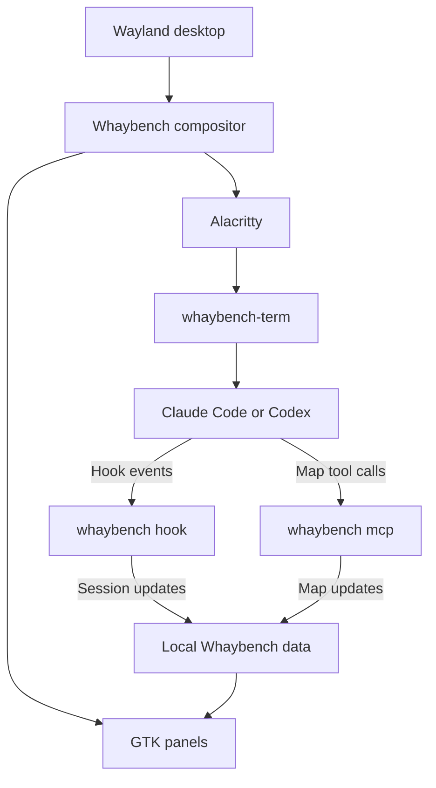

# Development

Use this page to see how Whaybench runs your agent and updates its panels. You can also build it from source and check
a change before you contribute it.

## See how Whaybench fits together

Whaybench is a Wayland compositor that runs inside your Wayland desktop. It gives the panels and Alacritty their own
Wayland connection. Each built-in panel runs as a separate process.



| Crate | What it does |
| --- | --- |
| `whaybench` | Runs the compositor with Smithay. The same binary provides `ctl`, `hook`, `record`, `map` and `mcp`. |
| `whaybench-panel` | Runs one GTK 4 panel per process. Its first argument selects the panel, such as `map` or `sessions`. |
| `whaybench-term` | Runs inside each Alacritty conversation tab. It starts the agent and relays terminal input and output. |
| `wb-core` | Shares data paths, translations, hooks, session records, maps and memory across the programs. |
| `wb-store` | Manages projects, documents, history and queues. It also builds `whaybench-project`. |
| `whaybench-tools` | Builds `whaybench-view` to work with views and `whaybench-files` to attach files to map nodes. |

If a built-in panel keeps crashing, Whaybench limits it to three starts in a minute. It leaves the panel closed and
shows **Panel crashed repeatedly · logged** when it reaches the limit.

## Follow an agent update

The Claude Code `context-map` plugin runs `whaybench hook claude`. The Codex add-on runs `whaybench hook codex`.
Both pass events on standard input to the same hook handler. The handler records the session on start and on prompts,
updates its state and heartbeat, and records file activity from supported tools.

At the end of a turn, the hook counts the turn and saves a nonempty answer. For Claude Code it tries to assemble the
whole turn from the transcript and falls back to the last assistant message. For Codex it saves the last assistant
message from the `Stop` event.

| What to check | Where to look in the data directory |
| --- | --- |
| Session record and state | `sessions/`, `cache/state/`, `cache/alive/` |
| Latest answer and answer history | `answers/`, `answer-log/` |
| Files reported by agent tools | `files/` |
| Nodes on the session's map | `<session-id>.json` at the data root |
| Node content and history | `memory/memory.db` |

Whaybench chooses the data directory from `--data-dir`, then `WHAYBENCH_DATA_DIR`, then `$XDG_DATA_HOME/whaybench`.
The fallback is `~/.local/share/whaybench`. A [Briefsafe project](guide/briefsafe.md) has its own data root.

**Sessions**, **Answer**, **Files** and **Conversation map** read these records. The map follows your selected session,
or the one that changed last when none is selected. If the terminal works but the panels stay empty after a turn, check
that the plugin or hooks are active.

## Add an agent

Claude Code is built in. Other agents live in your data directory under `addons/agents/<id>/`. The required
`agent.json` names the executable and can specify launch and resume arguments, settings templates and agent guidance.
An add-on that loads appears under **Sessions → New conversation**. A session reopens with its recorded agent.

To connect an agent to the panels, give it command hooks that send events to `whaybench hook` with its add-on ID.
To let it update the map, register `whaybench mcp` as an MCP server. Use the bundled Codex add-on as an example.
See the [agent add-on guide](../addons/agents/README.md).

## Trace the Codex connection

Choose **Sessions → New conversation → Codex**. The relay starts Codex with `--no-daemon` and
`--sandbox workspace-write`. When you reopen a session, it adds `resume` and the saved session ID.

For a regular tab, Whaybench sets `CODEX_HOME` to `<data>/codex`. The terminal relay, once the add-on is approved,
merges its MCP and sandbox settings into `config.toml` and writes `hooks.json`. The add-on copies the model and
reasoning settings when it first creates `config.toml`. It can share your usual Codex sign-in through an `auth.json`
link.

In the Codex tab, enter `/hooks` to review and trust the Whaybench hooks. The MCP server uses the session recorded by
the hooks, with the tab ID as a fallback. It returns an error if it cannot identify the session.

## Read or change a map

Both agents call the MCP tool `context_map`. The MCP server and the `map` command use the same code to apply updates.
Use the command to inspect or test a map. Set `session` to the session ID before using the first two commands.

```sh
whaybench map "$session"
whaybench map "$session" --write < change.json
whaybench map --file saved-map.json
```

| Update key | What it does |
| --- | --- |
| `upsert` | Adds or updates nodes by ID. |
| `remove` | Takes nodes and their descendants off this map. The nodes stay in memory. |
| `current` | Sets the node the conversation is on. |
| `nodes` | Replaces the session's list of nodes. Nodes the person deleted stay in **Deleted**. |
| `title` | Names the conversation, for the map tool only (`whaybench map` does not take it). |

Whaybench checks the result before saving. A duplicate ID in `nodes`, a missing parent or current node, or a parent
cycle leaves the stored map as it was. Repeated IDs in `upsert` apply in order. The caller gets an error and can retry
with a corrected update.

## Check what Codex can write

The Codex add-on configures these writable roots within the Whaybench data directory.

| Folder | What uses it |
| --- | --- |
| `view/`, `show/` | View requests and content to show |
| `projects/` | Project records and documents |
| `node-files/` | File attachments to map nodes |
| `ask/` | Requests Whaybench checks before delivering to another tab |
| `cache/subagents/` | Task records for work reported by another program |

These come on top of the conversation's working folder, and each launch sets them from the add-on. Keep these roots
narrow so Codex settings, add-ons and other tabs' input stay outside them. If Codex cannot create a project from the
sandbox, choose **New project** in the project panel.

## Build from source

You need Rust, Git, and the GTK 4 and WebKitGTK 6 development packages. On Fedora they are `gtk4-devel` and
`webkitgtk6.0-devel`. On Ubuntu and Debian they are `libgtk-4-dev` and `libwebkitgtk-6.0-dev`. For the full Ubuntu CI
package list, see `.github/apt-packages.txt`. Use a Wayland desktop to run the GUI and install Alacritty for
conversation tabs.

```sh
git clone https://github.com/Whaybench/whaybench
cd whaybench
tools/fetch-smithay.sh
cargo build --release
target/release/whaybench
```

The fetch script checks out the recorded Smithay revision and applies Whaybench's patches. If a patch fails, the
script stops and prints the patch and revision. Run Whaybench as your normal user.

## Test a change

Run the workspace tests. After changing `install.sh`, also run the installer check. It tests the package commands
for simulated distributions without installing packages.

```sh
cargo test --workspace
sh tools/test-install.sh
```

For a screen change, try an Alacritty panel. Give the test window a data directory of its own, or it replaces the
Whaybench you are using. Starting a build also points Whaybench's links in `~/.local/bin` at that build, until the
installed one starts again; set a temporary `HOME` to leave them alone. With Whaybench running, take a screenshot from a
second terminal.

```sh
cargo run --release -p whaybench -- --data-dir /tmp/wb-test --app alacritty
```

```sh
target/release/whaybench ctl --data-dir /tmp/wb-test shot --out /tmp/a.png
```

Keep screenshots outside the repository. They can contain conversation text. The capture command needs a running
instance under the same data directory.

After changing `mod/context-map`, `hook.rs`, `map_tool.rs` or `mcp.rs`, validate the plugin and build the release
binary. Check that `~/.local/bin/whaybench` resolves to your test build. With Claude Code signed in and the plugin
available, run a short session with a temporary data directory and check that it leaves a session record and a map that
holds the topic `test`.

```sh
claude plugin validate mod/context-map
cargo build --release
wb_test_data=$(mktemp -d)
WHAYBENCH_DATA_DIR="$wb_test_data" WHAYBENCH_TAB=t1 claude -p "Add a topic 'test' with the context_map tool." \
  --plugin-dir ./mod/context-map \
  --allowedTools=mcp__plugin_context-map_whaybench__context_map &&
  ls "$wb_test_data/sessions" && cat "$wb_test_data"/*-*.json
```

## Contribute a change

Follow [AGENTS.md](../AGENTS.md). Put screen text in `config/lang/en.ftl` and keep the same key order in each language
add-on. Keep agent-only text in English in `config/lang/ai.ftl`. Record noteworthy changes under `[Unreleased]` in
`CHANGELOG.md`, and report which checks you ran.

For a bug, include the steps to reproduce it, your distribution and desktop, your Whaybench version, and any terminal
error. Review logs in `logs/run/` under your data directory for folder names and conversation titles before sharing
them. File bugs and ideas in [Issues](https://github.com/Whaybench/whaybench/issues).
